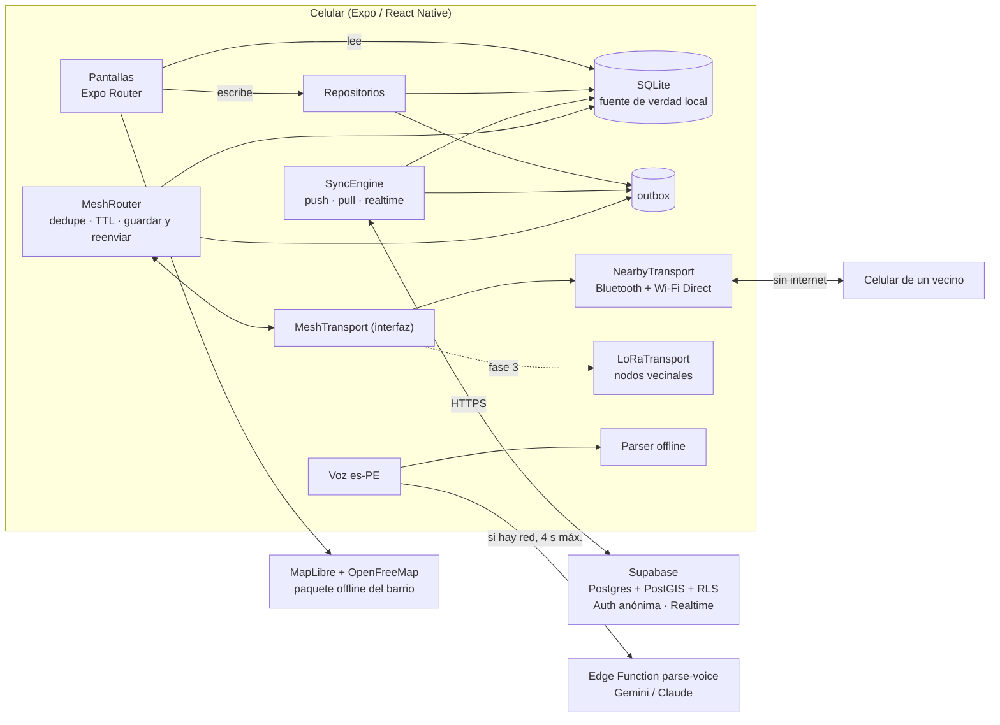

# Quadra · App vecinal

> **Quadra**: tu cuadra, conectada. Hoy te ayudo, mañana me ayudas.

Hackathon UTP · El Comercio 2026 · Equipo **PEAK**.

**Landing y descarga:** https://quadra-peak.vercel.app

App móvil (Android) para **encontrar servicios y productos recomendados por vecinos cerca de casa**, **intercambiar favores sin dinero** y, en una emergencia, **coordinar ayuda aunque no haya internet**: los mensajes viajan de celular en celular por Bluetooth y Wi-Fi Direct.

| | Modo Día a día | Modo Emergencia |
|---|---|---|
| **Servicios de Proximidad** | Directorio del barrio (oficios, profesiones, comida casera) con **Visto Bueno Vecinal** | **Directorio de apoyo**: enfermera, electricista, generador, camioneta |
| **Cadena de Favores** | Préstamos, donaciones, intercambios y **movilidad solidaria**, sin dinero | **Tablero de Ayuda Humanitaria** (SOS, Estoy bien, vecinos vulnerables) + **Economía Solidaria** (agua, baldes, medicinas, refugio) |

## Lo que nos diferencia

1. **Red vecinal sin internet ni hardware**: Google Nearby Connections (Bluetooth + Wi-Fi Direct). Cada celular guarda y reenvía los avisos (TTL 6 saltos, retención 6 h, sin duplicados). Quien recupera señal sube todo a la nube.
2. **Publicar por voz**: “vendo lasañas a 15 soles los sábados” → producto · comida · S/ 15 · sábados. LLM en una Edge Function (Gemini o Claude), con parser offline de respaldo.
3. **Visto Bueno Vecinal real**: solo vecinos que viven a ≤ 1.5 km y confirman “ya usé este servicio”. Lo valida el servidor con PostGIS.
4. **Máximo 3 toques para publicar**, con contador visible en modo demo.
5. **“Sin transporte mayor”**: todo muestra cuadras y minutos a pie; filtro “A pie · 1.5 km” activo por defecto.
6. **Quadri Points**: reputación solidaria (en el código y la base de datos la columna sigue llamándose `aynis`). Ayudar suma (+5), ofrecer ayuda también (+1), pedir nunca resta.
7. **Offline real**: todo se lee y se publica sin conexión; se sincroniza solo al volver la señal.

## Arquitectura



### Decisiones offline-first

- **Toda escritura** va primero a SQLite y a la tabla `outbox`; la UI **solo lee de SQLite**.
- `SyncEngine` corre al iniciar, al volver la señal y cada 30 s (10 s en emergencia): **push** de la outbox en orden (`upsert` idempotente por `id`), **pull** incremental por `updated_at` y **Realtime** para `emergency_reports` y `zones`.
- IDs UUID generados en el celular → se puede crear sin conexión. Si el vecino usó la app antes de tener sesión, sus registros se **remapean** al id anónimo de Supabase.
- `updated_at` lo fija el servidor (el pull no depende del reloj del celular). Conflictos: *last write wins*. Los reportes de emergencia nunca se pisan: un trigger solo deja cambiar `status`.
- En PostGIS, el cliente escribe `lat`/`lng` y `location` es una columna `geography` **generada**: misma forma de dato en SQLite y en Postgres.

### Seguridad (RLS)

RLS activo en todas las tablas: cada vecino lee su zona y escribe solo lo suyo. Los Quadri Points, el contador de Visto Bueno y el rol de junta vecinal **no se pueden autoasignar** (triggers). La junta vecinal se reclama con un PIN de zona (`claim_zone_admin`). Las API keys del LLM viven solo en los secrets de Supabase.

## Estructura

```
src/app/            rutas (Expo Router): (tabs), emergencia/(tabs), publicar, listing, favor
src/components/     UI reutilizable (QuadraMap, BigButton, ListingCard, FavorCard, ReportCard…)
src/data/           SQLite (db.ts), repositorios, SyncEngine, tipos
src/mesh/           MeshTransport (interfaz), NearbyTransport, MeshRouter
src/features/       sesión, catálogo, voz, publicar, mapa offline, arranque
src/lib/            supabase, geo, ubicación, conectividad, notificaciones, voz (TTS), contacto
src/seed/           datos demo para usar sin internet
supabase/           migraciones SQL, seed.sql, Edge Function parse-voice
scripts/            build-seed.mjs (genera seed.json y seed.sql con los mismos ids)
design/             referencia visual (no es código de la app)
```

## Correr en local

Requisitos: Node 22+, cuenta de Expo y un celular Android con el **dev build** instalado (no funciona en Expo Go: hay módulos nativos).

```bash
npm install                 # aplica también patches/ (patch-package)
cp .env.example .env        # completar EXPO_PUBLIC_SUPABASE_URL y EXPO_PUBLIC_SUPABASE_ANON_KEY
npm start                   # Metro para el dev build (mismo Wi-Fi que el celular)
```

Sin `.env` la app igual abre y funciona en modo local con los datos demo.

### Builds (EAS)

```bash
npx eas-cli@latest login
npm run build:dev           # APK de desarrollo (dev client)
npm run build:apk           # APK "preview" para instalar / GitHub Releases
npx eas-cli@latest update --channel preview   # actualización OTA
```

Las variables `EXPO_PUBLIC_*` están también en EAS (`eas env:create`), porque `.env` no se sube al repo.

### Landing

`landing/index.html` es estática (sin build). Despliegue: `cd landing && npx vercel deploy --prod`. El botón de descarga apunta a `releases/latest/download/quadra.apk` del repo.

### Supabase

1. Aplicar `supabase/migrations/*.sql` en orden.
2. `npm run seed` regenera `src/seed/seed.json` y `supabase/seed.sql`; aplicar `seed.sql` en el SQL Editor.
3. Authentication → Providers → habilitar **Anonymous sign-ins**.
4. Desplegar `supabase/functions/parse-voice` y crear los secrets `GEMINI_API_KEY` (y opcionalmente `LLM_PROVIDER=claude` + `ANTHROPIC_API_KEY`).

## Variables de entorno

| Variable | Pública | Uso |
|---|---|---|
| `EXPO_PUBLIC_SUPABASE_URL` | sí | URL del proyecto Supabase |
| `EXPO_PUBLIC_SUPABASE_ANON_KEY` | sí (protegida por RLS) | Clave publicable del cliente |
| `EXPO_PUBLIC_DEMO_WHATSAPP` | sí, opcional | Número del equipo para que los datos demo abran un WhatsApp real |
| `EAS_PROJECT_ID` | sí, opcional | Sobrescribe el proyecto de EAS |
| `GEMINI_API_KEY` / `ANTHROPIC_API_KEY` / `LLM_PROVIDER` | **no** (solo secrets de Supabase) | Parser de voz en la Edge Function |

## Guion de demo

1. Tutorial de 3 pantallas (botón “Escuchar”) → nombre → coach marks.
2. *Cerca de ti*: gasfitero a 2 cuadras con 5 vistos buenos → WhatsApp → “Ya lo usé · Dar Visto Bueno”.
3. Publicar por voz “vendo lasañas a 15 soles los sábados” en 3 toques (contador visible).
4. *Cadena de Favores*: Don Pedro pide muletas → “Yo te ayudo” (GPS o mapa). Movilidad al Colegio San Antonio con coincidencia.
5. Modo avión → publicar → quitar modo avión → se sincroniza solo (banner).
6. Perfil → junta vecinal (PIN demo `2026`) → Activar Modo Emergencia (sismo) → la app cambia a rojo.
7. Dos celulares en modo avión con Bluetooth: SOS en A aparece en B “vía red vecinal”. Con un tercero: A → B → C.
8. Uno recupera internet → el reporte sube y aparece en un tercer dispositivo online.

## Roadmap (escalabilidad)

- **Fase 2**: panel para municipalidades y juntas vecinales; activación oficial del Modo Emergencia; integración con alertas oficiales (INDECI) y reportes ciudadanos para medios (El Comercio).
- **Fase 3**: **Nodos Vecinales LoRa** (uno por cuadra, financiados por la municipalidad) que extienden la red vecinal a kilómetros. Solo hay que implementar `LoRaTransport` sobre la interfaz `MeshTransport`.

Componentes de terceros y licencias: [TERCEROS.md](TERCEROS.md).
